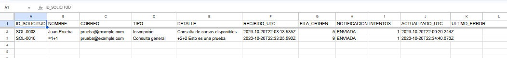
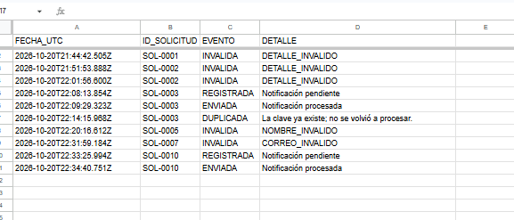
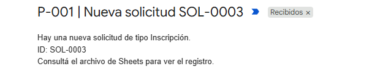

# Automatización de solicitudes con Google Apps Script

Sistema que recibe solicitudes desde Google Forms, valida los datos y los registra en Google Sheets. También envía un aviso por correo al responsable cuando llega una solicitud nueva.

## Funcionalidades

- Valida el identificador, el nombre, el correo y los demás campos del formulario.
- Evita registrar dos solicitudes con el mismo identificador.
- Guarda los registros aceptados en `Solicitudes` y los eventos en `Bitacora`.
- Procesa las notificaciones con un activador programado cada cinco minutos.
- Deja los envíos fallidos o de resultado incierto en estado `REVISION` para comprobarlos manualmente.

Las notificaciones incluyen el identificador y el tipo de consulta, pero no los datos personales del formulario.

## Tecnologías

Google Forms, Google Sheets y Google Apps Script (JavaScript). Las pruebas automatizadas utilizan Node.js, sin servicios pagos ni dependencias externas.

## Capturas de funcionamiento

Capturas de las pruebas en Google Sheets y del aviso recibido por correo. Se omitió el encabezado con la dirección del remitente.

### Solicitudes registradas



### Bitácora de eventos



### Notificación por correo



## Puesta en marcha

1. Creá un formulario con estas preguntas: `ID solicitud`, `Nombre`, `Correo`, `Tipo de consulta` y `Detalle`.
2. Para `Tipo de consulta`, usá las opciones `Inscripción`, `Consulta general` e `Información de cursos`.
3. Vinculá el formulario con una hoja de Google Sheets desde la pestaña **Respuestas**.
4. Desde esa hoja, abrí **Extensiones → Apps Script** e incorporá `src/Code.gs` y `src/Domain.gs`. Revisá también la configuración de `src/appsscript.json`.
5. En **Configuración del proyecto → Propiedades del script**, creá `ALERT_EMAIL` con el correo que recibirá los avisos.
6. Ejecutá `initializeP001` y autorizá los permisos. Esta función crea las hojas de trabajo y configura los activadores.
7. Enviá una respuesta con un ID como `SOL-0001`. Comprobá el registro en `Solicitudes`, el evento en `Bitacora` y el aviso por correo.

Para probar los duplicados, enviá otra respuesta con el mismo ID: debe quedar registrada como `DUPLICADA` en `Bitacora`, sin crear otra solicitud.

## Pruebas

Con Node.js 20 o superior:

```bash
npm test
```

El repositorio incluye 18 pruebas automatizadas que simulan las operaciones de Google. También se hicieron pruebas manuales con datos ficticios para validar registros, duplicados, avisos y fallos controlados.

## Estado y limitaciones

La implementación fue probada en un entorno propio de Google Apps Script, pero todavía no se utilizó con clientes reales. Si el activador de recepción falla antes de registrar una solicitud, no hay un mecanismo automático para recuperarla desde la hoja de respuestas. Los envíos de correo con resultado incierto requieren revisión manual.

Antes de utilizarla en un negocio habría que revisar permisos de acceso, límites de Google y mecanismos de supervisión y recuperación de errores.

## Permisos

El manifiesto `src/appsscript.json` declara los permisos para trabajar con la planilla vinculada, configurar activadores y enviar correos. Al copiar el manifiesto al proyecto de Google, comprobá los permisos solicitados y volvé a autorizarlo si es necesario.
